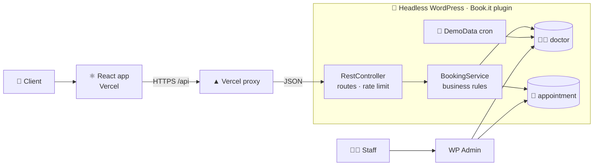

<div align="center">

# 🧩 Book.it — Backend

**Book.it is a lightweight appointment booking app: pick an expert, pick a free slot, book in under a minute.**
This repo is the **headless WordPress backend**: a custom plugin that stores experts and bookings and serves them as a REST API to the [🔗 React frontend](https://github.com/chomontbartosz/bookit-frontend). WordPress is never shown to clients, only to staff.

[🚀 **Live demo**](https://bookit-frontend-wheat.vercel.app) · [⚛️ Frontend repo](https://github.com/chomontbartosz/bookit-frontend)


</div>

---

## 💡 Concept

| | |
|---|---|
| 😩 **Problem** | Small practices book visits by phone or email: slow, error-prone, closed outside office hours. |
| ✅ **Solution** | WordPress as a **headless booking engine**: staff manage experts in a familiar admin, clients book through a fast, separate React app. |
| 👥 **For whom** | **Staff** use WP admin, no new tool to learn. **Developers** get a small, documented JSON API. |

---

## ✨ Features

- 👩‍⚕️ **Experts** as a custom post type: specialization, visit length, schedule
- 📅 **Appointments** as a custom post type: listed in WP admin, **never exposed via REST**
- 🔌 **3 REST endpoints**: list experts, check availability, book
- 🛡️ **Booking rules enforced on the server**: valid input, real expert, future slot from the schedule, not already taken
- 🔒 **No double bookings**, even when two requests arrive at the same moment (slot lock)
- 🚦 **Rate limiting**: max 10 booking attempts per client per 10 minutes
- 🕐 **Site time zone** for every "is it in the past?" check; past slots are hidden
- 🔄 **Self-refreshing demo data**: a daily cron creates fresh slots, so the demo never runs dry

---

## 🏗️ Architecture



**Layers:** `RestController` (HTTP) → `BookingService` (rules) → WordPress posts and meta (storage). Each layer only knows the one below it.

---

## 🔌 REST API

Base URL: `/wp-json/clinic/v1`

| Method | Endpoint | Purpose |
|---|---|---|
| `GET` | `/doctors` | List all experts |
| `GET` | `/doctors/{id}/availability` | Future slots of one expert, each with a `booked` flag |
| `POST` | `/appointments` | Book a slot |

<details>
<summary>📦 <b>Example requests and responses</b></summary>

**`GET /doctors`**
```json
[{ "id": 12, "name": "Anna Nowak", "specialization": "Cardiologist", "visit_duration": 30 }]
```

**`GET /doctors/12/availability`**
```json
[{ "date": "2026-10-20", "time": "08:30", "booked": false }]
```

**`POST /appointments`**
```json
{ "doctor_id": 12, "date": "2026-10-20", "time": "08:30",
  "patient_name": "Jan Kowalski", "patient_email": "jan@example.com" }
```
```json
{ "success": true, "appointment_id": 345 }
```

</details>

**Errors**: WordPress format `{ code, message, data: { status } }`. Checks run in this order, cheapest first:

| # | Status | Code | When |
|---|---|---|---|
| – | `429` | `too_many_requests` | More than 10 attempts in 10 min |
| 1 | `400` | `invalid_data` | Doctor, date (`YYYY-MM-DD`) or time (`HH:MM`) missing or malformed |
| 2 | `400` | `missing_patient_data` | Name or email empty |
| 3 | `422` | `invalid_email` | Email not valid |
| 4 | `400` | `past_date` | Slot is not in the future (site time zone) |
| 5 | `404` | `doctor_not_found` | No published expert with this ID (also on `/availability`) |
| 6 | `400` | `invalid_slot` | Slot is not in the expert's schedule |
| 7 | `409` | `slot_taken` | Slot already booked |
| – | `500` | `booking_failed` | Database write failed |

The frontend translates these codes, so **messages can change without breaking the UI**.

---

## 🗃️ Data model

| Post type | Field | Type | Notes |
|---|---|---|---|
| 👩‍⚕️ `doctor` | `post_title` | string | Expert's name |
| | `specialization` | string | e.g. "Cardiologist" |
| | `visit_duration` | integer | Minutes |
| | `availability_slots` | JSON string | `[{ "date": "YYYY-MM-DD", "time": "HH:MM" }]` |
| 📅 `appointment` | `post_title` | string | `date time · expert · patient` (readable list in WP admin) |
| | `doctor_id` | integer | → `doctor.ID` |
| | `date` / `time` | string | Booked slot |
| | `patient_name` / `patient_email` | string | Sanitized on save |

A slot is **booked** when an `appointment` with the same `doctor_id` + `date` + `time` exists. Availability is computed on every request, never stored twice, so schedule and bookings can't drift apart.

---

## 🧠 Technical decisions

| Decision | Why |
|---|---|
| 🧩 **Headless WordPress** | Free admin panel, user roles, auth, backups and cheap hosting. Staff need no training; clients never see WP. |
| 📝 **Custom post types + post meta** (no custom tables) | Native storage: works with WP admin, exports and migrations out of the box. |
| 🧱 **Layers: controller → service → storage** | HTTP concerns (routes, rate limit) are kept apart from business rules, so each can be read and tested on its own. |
| 📛 **`Schema` class for all names** | Post types, meta keys, namespace and formats are defined once. A typo can't create a second meta key. |
| 🚨 **`Errors` class for all errors** | Code, HTTP status and message in one table: the API contract at a glance. |
| 🔒 **Slot lock via `add_option`** | `option_name` is unique in the database, so `add_option` is atomic and works as a mutex without extra infrastructure. |
| 🙈 **`appointment` hidden from REST** | Patient data is readable only by logged-in staff in WP admin. |
| 🌐 **Client IP from `X-Forwarded-For`** | Behind the Vercel proxy every request comes from Vercel; the real client is the first forwarded address. |
| 🔄 **Cron + freshness check on `init`** | WP-Cron only runs on traffic, so the plugin also regenerates data older than 24 h. The demo stays alive with zero maintenance. |

---

## 🗂️ Project structure

Every concern has **exactly one home**. Everything else references it.

```text
book-it/                       📦 Plugin folder → wp-content/plugins/
├── book-it-app.php            🚪 Bootstrap: plugin header, loads classes, wires WP hooks
└── includes/
    ├── Schema.php             📛 All names: post types, meta keys, REST namespace, formats
    ├── Errors.php             🚨 All API errors: code → status + message
    ├── PostTypes.php          🗃️ Registers post types + meta fields
    ├── BookingService.php     🧠 Business rules: doctors, availability, booking, slot lock
    ├── RestController.php     🔌 Routes, input parsing, rate limiting
    └── DemoData.php           🔄 DEMO ONLY: daily random slots
```

### 📌 Single source of truth

| What | Defined only in | Used via |
|---|---|---|
| Post type and meta names | `Schema` | `Schema::DOCTOR`, `Schema::META_SLOTS` |
| Error codes and statuses | `Errors` | `Errors::create('slot_taken')` |
| Booking rules | `BookingService` | `$service->book($input)` |
| Routes | `RestController::register_routes()` | `/wp-json/clinic/v1/...` |
| WP hooks | `book-it-app.php` | – |
| Demo settings | `DemoData` constants | – |

---

## 🚀 Installation

1. Copy the `book-it/` folder to `wp-content/plugins/`
2. Activate **Book.it** in **WP Admin → Plugins**
3. Add experts in **WP Admin → Doctors**: title = name, custom fields `specialization` and `visit_duration`
4. Check that it works: open `https://your-site/wp-json/clinic/v1/doctors`

**Requirements:** WordPress 6.0+, PHP 8.0+

**Upgrading from 0.0.1:** replace the whole `book-it/` folder. The old `book-it-cron.php` can be deleted; the main file name is unchanged, so the plugin stays active.

---

## 🛣️ Roadmap

- [ ] 📄 OpenAPI spec as the shared contract (TypeScript types for the frontend generated from it)
- [ ] 🧪 PHPUnit tests for `BookingService`
- [ ] 🤖 CI: PHPCS (WordPress Coding Standards) + PHPStan
- [ ] 📝 `CHANGELOG.md` + Conventional Commits + GitHub Releases
- [ ] 🗓️ Admin UI for weekly schedules (instead of JSON in a custom field)
- [ ] 📧 Confirmation email to the patient